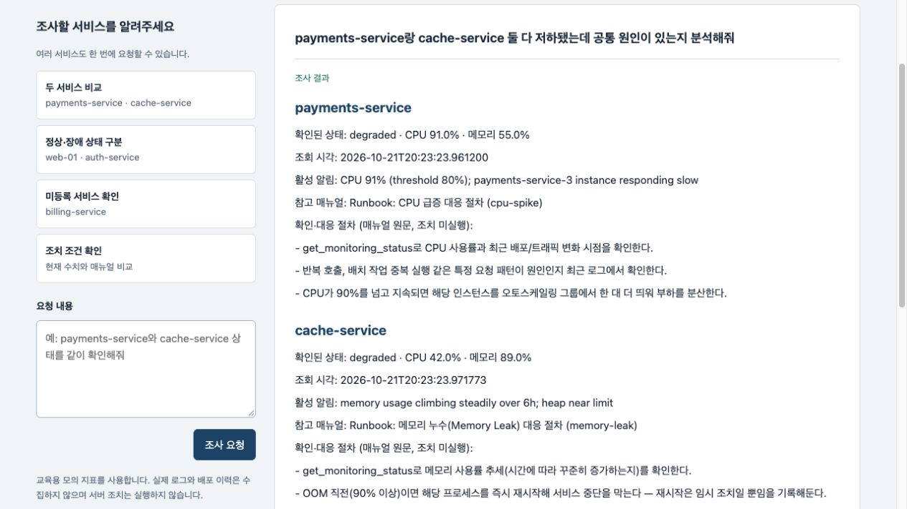

# 서비스 장애 진단 AI 에이전트

서비스 이름과 장애 증상을 입력하면 모니터링 지표와 대응 매뉴얼을 조회해 진단 보고서를 보여주는 AI 에이전트입니다. 실습 1의 베이스 프로젝트를 바탕으로, 요청한 대상을 빠짐없이 조사하고 수집한 근거에 맞게 답변하도록 개선했습니다.

[발표자료 보기](https://canva.link/0qx76m2u9f9d6vm) · [최종 PPT 다운로드](output/presentation/incident-diagnosis-agent-submission.pptx) · [결과 보고서](REPORT.md)

## 주요 기능

- 자연어로 입력한 서비스 이름과 증상을 바탕으로 모니터링 상태를 조회합니다.
- 여러 서비스를 요청하면 각각 조사하고 서비스별 상태와 대응 절차를 보여줍니다.
- 실제 조회한 서비스·관측 수치·참고 매뉴얼과 추가 확인이 필요한 항목을 함께 표시합니다.

## 개선 사항

| 확인한 문제 | 개선한 동작 |
|---|---|
| 두 서비스를 요청해도 하나만 조사 | 요청한 등록 서비스마다 조회 작업을 구성하고 누락을 보완 |
| 미등록 서비스나 서비스명이 없는 요청을 auth-service로 처리 | 다른 서비스로 대체하지 않고 조사할 서비스 이름을 확인 |
| 정상 상태에도 장애 매뉴얼 연결 | 정상·정보 부족·장애 조사를 구분하고 서비스별 관측 알림으로 검색 여부 결정 |
| 수집하지 않은 분석과 달라진 수치가 답변에 포함 | 서비스·수치·매뉴얼·절차 번호를 수집 결과와 대조하고 검증한 절차는 원문으로 표시 |

일반 대화에서는 사용자와 비서의 발화를 구분해 사용자가 밝힌 이름으로 답하도록 보완했습니다.

## 추가 기능

- **RAG 매뉴얼 검색:** 기존 매뉴얼 6개의 본문과 한·영 증상 설명을 bge-m3로 임베딩합니다. 문서 벡터는 SQLite에 저장하고, 서비스별 알림과 유사한 문서를 검색해 MCP Resource 원문과 연결합니다.
- **답변 근거 표시:** 모델이 작성한 출처 문장 대신 실제 수집 결과를 화면에 표시합니다. 미등록 대상과 미확인 사항도 확인할 수 있습니다.
- **회귀 테스트와 전후 비교:** 단위 테스트로 핵심 분기를 확인하고, 같은 질문과 고정 지표로 실제 조회 대상과 매뉴얼 선택을 비교합니다.

## 사용 기술

Python, FastAPI, LangGraph, MCP, Ollama, bge-m3, SQLite, HTML·JavaScript를 사용했습니다. 기존 LangGraph와 MCP 흐름을 활용하고, 대상 확인·수집·검색·보고·검증을 모듈로 분리했습니다. 검색기를 의존성 주입으로 연결해 실제 MCP 검색과 고정 데이터 평가용 구현을 교체할 수 있게 했습니다.

## 개선 전후 비교

같은 질문 20개와 고정 모니터링 지표로 비교했습니다.

| 평가 항목 | 개선 전 | 개선 후 |
|---|---:|---:|
| 필요한 서비스 조회 | 17/20건 | 20/20건 |
| 질문별 조회 대상 전체 일치 | 15/20문항 | 20/20문항 |
| 단일 정답 매뉴얼 선택 | 11/12문항 | 12/12문항 |

세 지표는 조사 대상과 문서 선택을 평가한 결과입니다. 진단 전체의 정확도를 뜻하지 않습니다. 단위 테스트 31개와 실제 MCP·SSE 통합 검증 기록도 보존했습니다. 자세한 판정 기준과 원시 기록은 [결과 보고서](REPORT.md)에서 확인할 수 있습니다.

## 한계

교육용 모의 지표와 매뉴얼 6개를 사용합니다. 실제 로그·시계열·서비스 의존 관계를 수집하지 않아 근본 원인과 공통 원인을 확정할 수 없습니다. 대응 절차를 안내하며 서버 조치를 실행하지 않습니다.

임베딩 검색에는 지연과 오검색 가능성이 있고, 매뉴얼 원문을 출력하는 방식은 상황에 맞춘 종합 설명을 제한합니다. 실제 운영 데이터와 새로운 질문에 대한 검증이 필요합니다.

[원본과 변경 모듈](docs/CHANGES.md) · [실행·평가 재현](docs/REPRODUCE.md) · [사례별 구현과 실행 증빙](docs/EVIDENCE.md)
