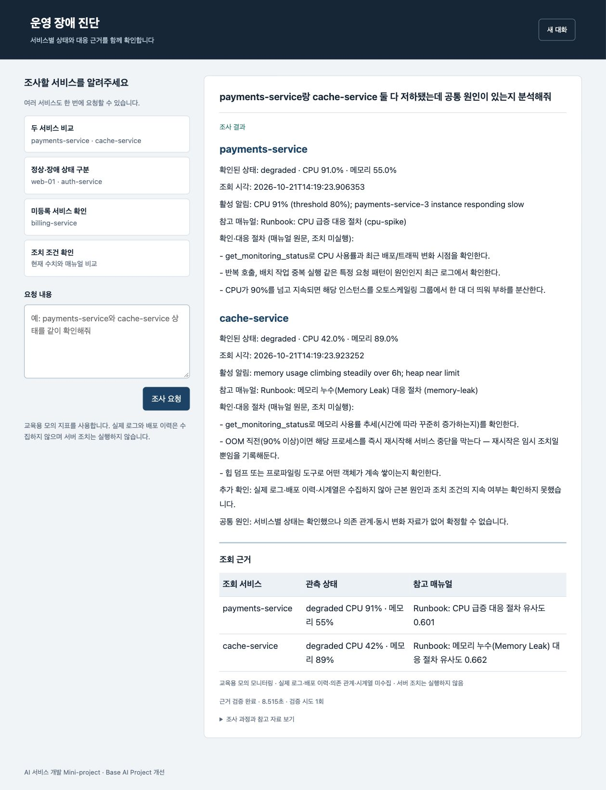
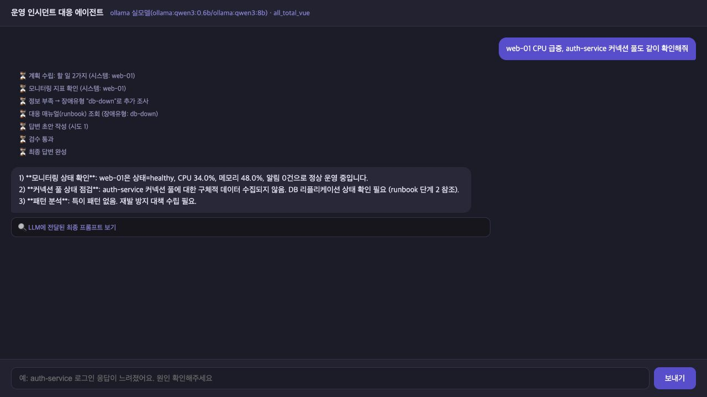
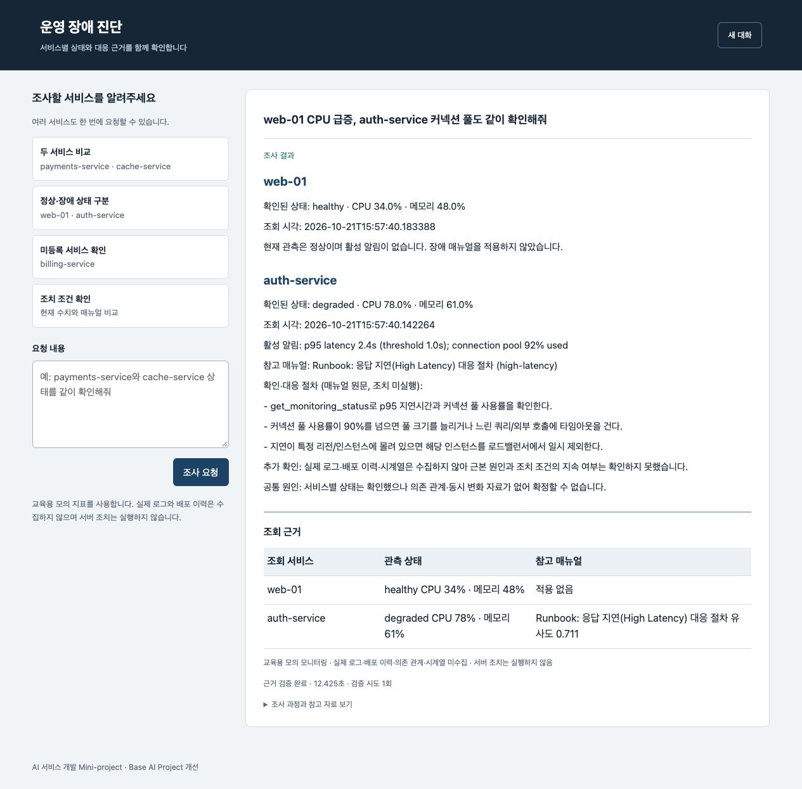
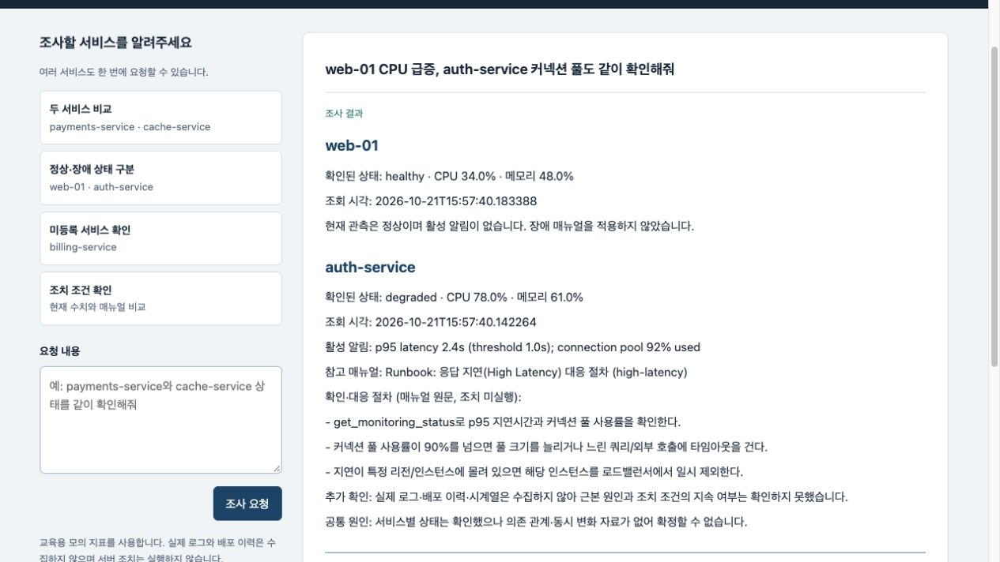
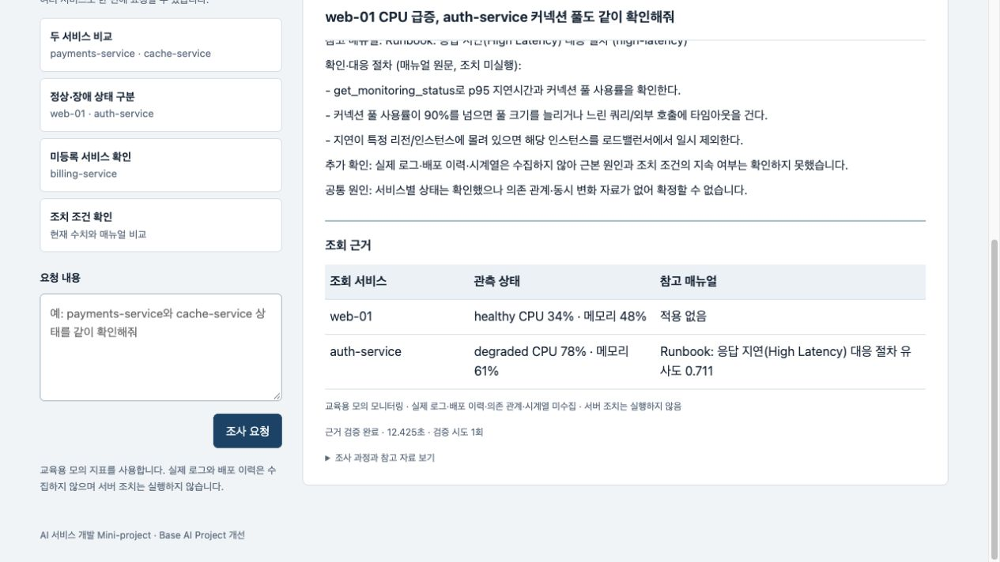
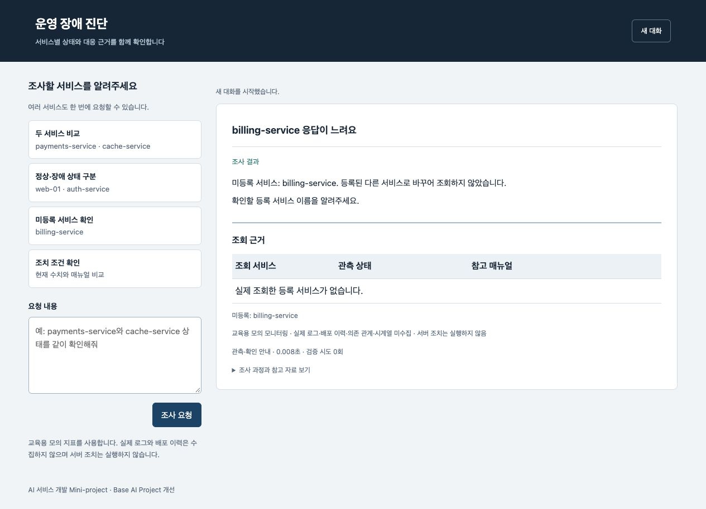
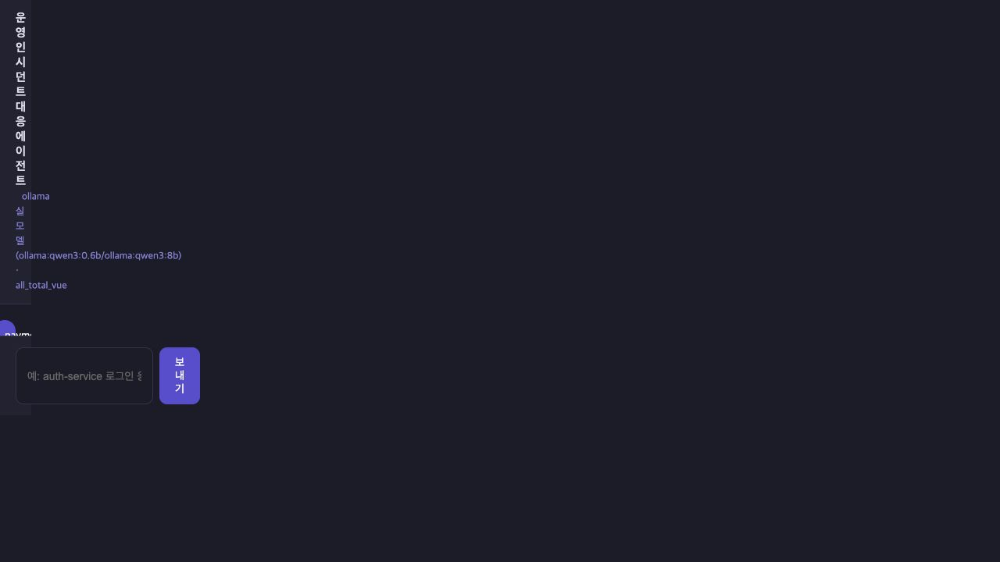
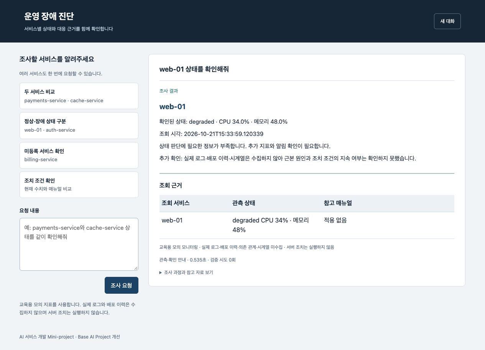
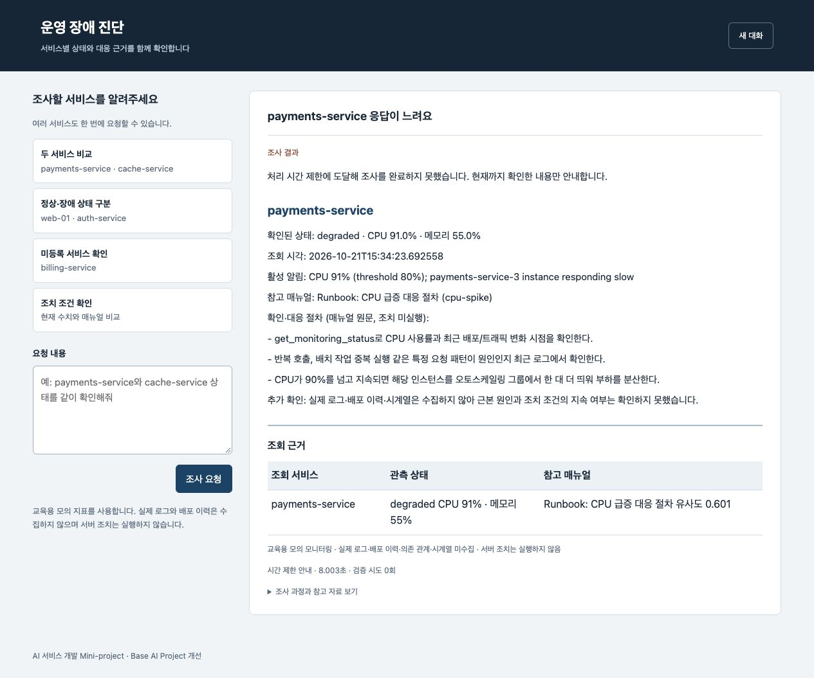
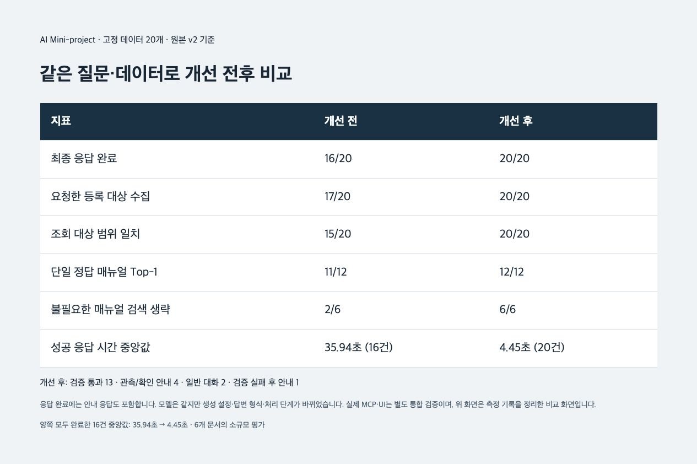

# 운영 장애 진단 AI 에이전트 개선

이진형 · 과제 1: Base AI Project 개선 · 2026-10-21 구현·검증

[발표자료 다운로드](output/presentation/incident-diagnosis-agent-context.pptx) · [발표 연습과 예상 질문](presentation/REHEARSAL.md)

## 1. 주제와 문제

서비스 이름과 증상을 입력하면 모니터링 상태와 대응 매뉴얼을 확인하는 에이전트다. 대표 문제는 `payments-service랑 cache-service 둘 다 저하됐는데 공통 원인이 있는지 분석해줘`라는 요청에서 payments만 조사하고 cache를 포함한 원인을 추정하는 동작이었다.

목표는 요청한 대상을 빠짐없이 조사하고, 관측한 사실과 추가 확인이 필요한 내용을 구분하는 것이다. 실제 서버 조치를 자동 실행하거나 근본 원인을 확정하는 기능은 범위에 넣지 않았다.

## 2. 개선 사항과 추가 기능

| 개선 | 변경한 동작 | 확인 사례 |
|---|---|---|
| 대상 누락·임의 대체 방지 | 명시한 등록 대상 전체와 계획을 대조, 실패한 대상은 별도 표시 | D05·D06·D07 다중 대상, D08 미등록, E06 혼합 |
| 상태별 매뉴얼 선택 | 정상·정보 부족은 검색 생략, 서비스별 관측 알림으로 검색 | D10 정상, E05 정상 복수 대상 |
| 근거와 조치 조건 검증 | 서비스·수치·문서·절차 번호 대조, 원인 확정 거절, 조건은 원문 출력 | D11 로그 미수집, D12 CPU 89.1%와 알림 91% |
| 생성·실패 처리 | 생성 512토큰, 호출 25초·전체 60초 기본 상한, 최대 2회 후 사실 중심 안내 | E06 검증 실패, 단위 테스트의 시간 초과·부분 실패 |

추가한 기능은 RAG 매뉴얼 검색, 실제 조회 서비스·매뉴얼·미확인 사항을 보여주는 근거 화면, 같은 질문·고정 데이터의 회귀 평가다.

미등록·미명시 요청의 auth 기본 처리는 원래 설계였다. 이 부분은 원래 회귀 기준의 오류가 아니라 대상 확인 안내로 바꾼 정책 개선이다. 이름 기억은 새 주요 기능으로 늘리지 않고 사용자 역할과 서버 재시작 유지의 회귀 검증에 포함했다.

## 3. 사용 기술과 변경 범위

| 기술 | 베이스에서 활용 | 직접 추가·변경 |
|---|---|---|
| LangGraph·FastAPI | 그래프 흐름·HTTP·SSE·수명 관리 | 범위 확인·수집·검색·검증 노드, 전체 요청 제한과 실패 응답 |
| MCP | 모니터링 Tool·매뉴얼 Resource·절차 Prompt | search_runbooks Tool, 검색 결과와 원문 연결 |
| RAG | 없음 | bge-m3, 한·영 증상 설명과 매뉴얼 본문 임베딩, SQLite 저장, 코사인 검색 |
| 의존성 주입·모듈화 | SupervisorDeps | 대상 식별·수집·검색·보고·검증을 분리, 검색 의존성 교체 |
| 테스트·평가 | 수업의 회귀 입력 | 핵심 단위 테스트 31개, 고정 데이터 20개, 대표 사례 3회 반복, 실제 MCP·SSE·재시작 검증 |
| 화면 | 수업 Vue 화면은 원본에 보존 | 외부 CDN 없는 HTML·JavaScript, 근거와 미확인 사항 표시 |

LLM은 계획을 제안하고 수집한 관측과 문서의 절차 번호를 구조화해 정리한다. 실제 조회 범위는 코드가 제한한다. 검증된 선택을 매뉴얼 원문으로 출력해 조건을 재작성하지 않는다. 이는 자유 생성 문장 전체의 의미를 검증하는 범용 사실성 평가기는 아니다.

기존 기술을 직접 새로 만들었다고 주장하지 않는다. 전문 멀티에이전트 확장이나 LangSmith 연결 검증은 이번 성과에 포함하지 않았다. OpenAI 경로는 보존 원본에 있으며 개선 버전은 Ollama를 검증했다.

## 4. 구현·최종 실행 화면

### 다중 서비스 조회와 근거

아래는 실제 개선 UI에서 두 서비스를 조회한 화면이다. payments에는 CPU, cache에는 메모리 매뉴얼이 연결된다. 공통 원인은 추가 자료가 없어 미확인으로 안내한다.

### 원본의 문제와 같은 입력의 개선 결과

원본에 `web-01 CPU 급증, auth-service 커넥션 풀도 같이 확인해줘`를 입력했다. 실제 진행 기록은 web-01만 조회하고 db-down 문서를 선택했다. 답변은 healthy·CPU 34%·메모리 48%·알림 0건을 인용하면서 auth 미수집과 DB 리플리케이션 확인을 안내했다.

최종 프롬프트도 web-01 지표와 DB Down 문서만 포함했다. 개선 버전은 같은 입력·고정 모의 지표에서 두 서비스를 조회하고 정상 web의 문서 검색은 생략하며 auth에 high-latency 문서를 연결했다. 아래 정상·장애 구분 화면이 해당 개선 결과다.

### 정상·장애 구분

web-01은 healthy·활성 알림 없음으로 문서 검색을 생략하고, auth-service는 응답 지연 매뉴얼을 연결했다.

### 실제 질문·응답과 모델 원문

현재 발표는 질문과 최종 답변이 함께 있는 실제 viewport를 사용한다. 긴 답변은 같은 요청의 연속 화면으로 보여주며 전체 페이지 원본도 보존했다. 질문 고정 표시는 CSS 변경이며 답변 문장은 편집하지 않았다.

LLM이 실제 반환한 값은 서비스·수치·문서 ID·절차 번호의 JSON이다. 검증 후 코드가 관측과 매뉴얼 원문으로 최종 보고서를 구성한다. 미등록·정보 부족 안내는 보고 LLM을 호출하지 않는다. [질문별 실제 기록](day2/results/contextual-captures/SUMMARY.md)과 [화면별 출처](presentation/EVIDENCE_INDEX.md)를 연결했다. 이 새 호출은 기존 20건 통계와 별도다.

### 미등록 서비스

billing-service를 auth-service로 바꾸어 조회하지 않고 확인할 등록 서비스 이름을 요청한다.

### 같은 입력의 원본 실행

원본은 payments만 조회한 뒤 분석 단계에서 `httpx.ReadTimeout`이 발생해 최종 답변을 완료하지 못했다. 아래는 원본 UI에 남은 진행 기록이다. 원본을 성공 응답한 화면처럼 재구성하지 않았다. 두 UI 시연은 base 모의 수치를 같게 고정했고 조회 시각은 각 호출 시각이다.

[시연 조건](day2/evidence/ui-capture-context.json)과 [실제 MCP 통합 기록](day2/results/integration/SUMMARY.md)은 고정 데이터 그래프 평가와 구분한다.

### 정보 부족과 시간 초과의 제어 시험

정보 부족은 web-01을 degraded·알림 없음으로 고정한 입력이다. 임의의 장애 매뉴얼을 선택하지 않고 추가 지표를 요청했다.

시간 초과는 보고 생성 의존성을 30초 지연시키고 시험용 요청 상한을 8초로 낮췄다. 약 8초 뒤 안내하면서 이미 수집한 CPU 91%·메모리 55%를 보존했다. 일반 설정의 요청 상한은 60초다. 이 시험을 20건 비교나 일반 성능에 합산하지 않았다.

[원시 이벤트와 제어 조건](day2/results/presentation-scenarios/SUMMARY.md) · [계획별 구현·발표 대응](presentation/PLAN_COVERAGE.md)

## 5. 동일 입력의 개선 전후 비교

20건 비교 후 미등록 확인 요청과 시간 초과 안내 문구를 보완했다. 아래 수치는 문구 보완 전 측정 기록이며 전체 통계를 다시 측정하지 않았다. 조사·검색·검증·제한 로직은 유지하고, 새 문구·실패 분기는 별도 실제 UI 시험과 단위 테스트로 확인했다.

질문 20개·고정 모니터링 데이터·qwen3:0.6b/8b 설정·세션 분리를 맞췄다. 데이터 해시 일치를 확인했다. 실제 MCP 전송 대신 같은 고정 데이터 어댑터를 사용한 그래프 평가이며, 임베딩 검색은 실제 bge-m3를 사용했다.

| 지표 | 개선 전 | 개선 후 |
|---|---:|---:|
| 최종 응답 완료 | 16/20 | 20/20 |
| 요청한 등록 대상 수집 | 17/20 | 20/20 |
| 조회 대상 범위 일치 | 15/20 | 20/20 |
| 단일 정답 매뉴얼 Top-1 | 11/12 | 12/12 |
| 불필요한 매뉴얼 검색 생략 | 2/6 | 6/6 |
| 성공 응답 시간 중앙값 | 35.94초·16건 | 4.45초·20건 |

응답 완료에는 안내 응답도 포함한다. 개선 후 20건은 구조화 검증 통과 13건, 관측·대상 확인 안내 4건, 일반 대화 2건, 검증 실패 후 안내 1건이다. E06은 두 번의 생성에서도 서비스 범위를 벗어나 반려됐고 payments 관측·매뉴얼 원문과 billing 미등록 안내를 반환했다.

등록 대상 수집률은 서비스 개수를, 범위 일치는 질문 개수를 분모로 한다. Top-1은 정답 문서가 하나인 12건만 계산하고, 검색 불필요 6건에는 일반 대화 2건도 포함한다. 양쪽 모두 완료한 16건만 비교한 중앙값은 35.94초 → 4.45초다.

개선 후에는 think=false, 512토큰 상한, 호출·요청 제한, 구조화 출력과 분기 변경을 적용했다. 이 변경들이 지연 차이에 함께 영향을 줬으므로 RAG만의 효과로 해석하지 않는다. 문서 본문에 한·영 증상 설명도 보강했다. 원본의 가상 비용이나 시간 초과로 누락된 토큰을 실제 비용 절감으로 제시하지 않는다.

### 반복 실행과 검색 부담

대표 개발 사례를 양쪽에서 각 3회 실행했다. 단일 입력의 최저 시간을 성능으로 고르지 않고 중앙값을 사용했다.

| 사례 | 원본 중앙값 | 개선 중앙값 | 조회 범위 일치 전/후 |
|---|---:|---:|---:|
| D02 메모리 | 35.75초 | 4.170초 | 3/3 → 3/3 |
| D05 gateway·payments | 40.01초 | 7.785초 | 0/3 → 3/3 |
| D08 미등록 billing | 35.54초 | 0.006초 | 0/3 → 3/3 |

별도 6개 문서 인덱스 구축은 0.554초, 개발용 증상 5개×3회 검색의 중앙값은 0.040초였다. 이미 설치된 모델과 OS 캐시를 사용했고 다운로드·서버 시작 시간은 제외했다. 전체 요청 측정에서는 인덱스 구축과 모델 워밍업을 제외했다.

[사례별 결과와 조건](day2/results/comparison/REPORT.md) · [반복 측정 원문](day2/results/comparison/repeats.json) · [검색 부담 원문](day2/results/comparison/retrieval-overhead.json)

## 6. 한계와 트레이드오프

- 문서 6개·질문 20개의 작은 교육용 데이터다. 평가용 6개는 검색 기준을 조정하는 데 사용하지 않았지만 이미 관측한 시험 세트이므로 새로운 독립 검증 데이터가 필요하다. 운영 환경의 정확도나 통계적 유의성을 주장하지 않는다.
- 단일 시점 모의 지표와 알림만 있다. 실제 로그·배포·시계열·서비스 의존 관계가 없어 근본 원인·공통 원인·복구를 확정하지 않는다.
- RAG 초기 테스트에서 영어 알림과 한국어 문서의 검색 오류가 있어 한·영 증상 설명을 보강했다. 유사도는 정답 확률이 아니며 미지원 장애의 검색 거절, 같은 서비스의 복합 장애는 추가 검증이 필요하다.
- 원문 기반 출력은 조건 변형을 줄이는 대신 자유로운 종합 설명의 범위를 제한한다. 문서가 잘못되거나 오래되면 이 검증만으로 해결할 수 없다. 실제 조치의 조건 충족 여부를 자동 판정·실행하지 않는다.
- 검증 후 전송하므로 장애 답변의 초안을 즉시 보여주지 않는다. 시간·생성량 제한은 긴 대기를 줄이지만 E06처럼 안내 응답으로 끝날 수 있다.
- 대상은 등록 목록을 기준으로 제한한다. 오타·새 별칭·알 수 없는 서비스는 추가 확인이 필요하며 자율적인 조사 대상 확장은 지원하지 않는다.
- SQLite 전수 벡터 비교를 사용했다. 대규모 검색·동시 사용자 부하·OpenAI 백엔드는 검증 범위 밖이다.

## 7. 최종 검증과 발표 준비

- 단위 테스트 31개: 누락·미등록·정상·부분 실패·조회 시간 초과·잘못된 수치·원인 확정·없는 절차·이름 질문·전체 요청 제한 확인
- 실제 MCP·프록시·SSE: 10개 시나리오의 11개 요청에서 대상·문서·종료·최종 내용 일치 확인
- 의도적 최초 모니터링 실패: 재시도 1회 후 복구
- SQLite: 새 서버 PID에서 같은 DB·thread를 유지한 뒤 사용자 이름을 올바르게 응답
- 실행 스크립트: 기존 포트 사용 중이면 중단하며 프로세스·DB 유지
- 원본 47개 파일 해시 보존, 평가 데이터와 지표 검사 통과

초기 통합 검증에서는 이름 질문을 새 선언으로 읽는 오류를 발견했다. 선언에 종결 표현을 요구하도록 수정하고 회귀 테스트를 추가한 뒤 전체 평가와 통합 검증을 다시 실행했다. 첫 실패 기록은 로컬에 보존했다.

[실행·평가 재현](docs/REPRODUCE.md) · [원본과 변경 모듈](docs/CHANGES.md) · [단위 테스트 결과](day2/tests/unit-tests.txt) · [최종 점검](day2/FINAL_REVIEW.md)

AI 도구를 코드 작성·시험 자동화·자료 작성에 사용했다. 수치의 분모·실패 사례·비교 조건을 확인했고, 의미 정확도의 독립적인 전문가 평가는 수행하지 않았다. 발표는 표지 1장과 본편 8장(노트 목표 4분 20초), 질문용 부록 6장으로 구성했다.
